<div align="center">


<br/>

[](https://git.io/typing-svg)

<br/>


<br/>

[](https://qerk0.github.io/BoraMertKalkanCV.github.io/)
[](https://www.linkedin.com/in/bora-mert-kalkan/)
[](mailto:kalkanboramert@gmail.com)
[](https://github.com/qerK0)

<br/>


</div>

---

## ⚡ About



I'm a **Software Engineering student** at Eastern Mediterranean University on a **full scholarship** — building at the intersection of **game development**, **artificial intelligence**, and **full-stack engineering**.

My engineering foundation spans **Unity / C# / Unreal Engine** game pipelines and extends into **AI-powered systems**, **web development**, and **modern software architectures**. I approach every product with a performance-first, impact-driven mindset.

I run **Plursus**, my indie game studio, and I'm on the outreach team of **GDND** (EMU Game Design & Development Club), bringing game/software industry speakers to campus. Previously Corporate Relations lead at **EMU IE Club**.

<br/>

**🔍 Open To**
- Software Engineering Internships
- AI / ML Research Collaboration
- Game Development Projects
- Full Stack & Mobile Development Roles
- Open Source Contributions

<br clear="right"/>

---

## 🛠 Tech Stack

**Languages**

<p>

</p>

**Frontend**

<p>

</p>

**Backend & Databases**

<p>

</p>

**Cloud, DevOps & Tooling**

<p>

</p>

---

## 🤖 AI / ML Expertise

| Domain | Proficiency | Details |
|:---|:---:|:---|
| **Large Language Models** | ★★★★☆ | Prompt engineering, system prompt design, LLM integration pipelines |
| **Transformer Architecture** | ★★★☆☆ | Attention mechanisms, BERT/GPT internals, tokenization concepts |
| **Game AI Systems** | ★★★★☆ | NPC behavior, pathfinding, FSMs and decision trees in Unity/Unreal |
| **Machine Learning Fundamentals** | ★★★☆☆ | Supervised/unsupervised learning, model evaluation, feature engineering |
| **Data Engineering** | ★★★☆☆ | Data pipelines, preprocessing, pandas/numpy ecosystem |
| **Computer Vision** | ★★☆☆☆ | Image processing fundamentals, OpenCV, object detection basics |

---

## 🚀 Featured Projects

<details open>
<summary><b>🃏 KUT — Roguelike Card Game · Plursus</b></summary>
<br/>

A Balatro-style roguelike deckbuilder built on **Amerikano**, the classic rummy-style card game. Leftover cards feed a **ledger ("defter") penalty system** that builds toward a limit — the game's signature mechanic. Deities from Egyptian, Greek and Turkic myth bend the rules at the table, and Old Turkic runes spell out their blessings.

| | |
|:---|:---|
| **Stack** | Unity · C# |
| **Platform** | PC (Windows) |
| **Program** | GameDev.ist **Deep Jam '26** accelerator |
| **Playtest** | 46 players at a live developer meetup |
| **Status** | In development — UI/visual overhaul in progress |
| **Page** | [plursus.itch.io/kut](https://plursus.itch.io/kut) |

<br/>
</details>

<details>
<summary><b>🏚️ İstanbul Afet Bölgesi — Civil Game Jam 2026</b></summary>
<br/>

48-hour jam game made at Civil Game Jam (ODTÜ KALTEV). A linear earthquake-escape game: get out of a 6th-floor apartment alive while AFAD alerts and aftershocks escalate — Henry Stickmin-style choices that teach what *not* to do in an earthquake.

| | |
|:---|:---|
| **Stack** | Unity 6 · C# · 2.5D isometric |
| **Team** | 3 people — I was the programmer and built the core mechanics |
| **Build** | Windows, shipped within the 48h deadline |

<br/>
</details>

<details>
<summary><b>🌾 Cozy Farming Game · Plursus</b></summary>
<br/>

A small 2D farming game. Just plant, water and harvest. Nothing else. 🙂

| | |
|:---|:---|
| **Stack** | Unity 6 · C# · 2D |
| **Platform** | PC |
| **Page** | [plursus.itch.io/cozy-harvest](https://plursus.itch.io/cozy-harvest) |

<br/>
</details>

<details>
<summary><b>⚔️ Plursus Arena — Viewer-Voted Gladiator Series (WIP)</b></summary>
<br/>

A turn-based pixel-art gladiator game built as an interactive series: AI plays the fights, LLM-driven bosses (Gemini / DeepSeek) adapt, and viewers vote on gear and life-or-death moments through Instagram polls. Deaths are permanent; items pass down to the next gladiator.

| | |
|:---|:---|
| **Stack** | Unity · C# · LLM APIs · LPC pixel art |
| **Platform** | PC, recorded for short-form video |
| **Status** | In development |

<br/>
</details>

<details>
<summary><b>🎮 CaveMans — First Indie Studio (2021–2022)</b></summary>
<br/>

My first studio — 3 PC games released on itch.io:

- **Ratio Errorem Gladius** — action, robot gladiator (Unreal Engine)
- **AstroTest** — puzzle, spacesuit testing (Unreal Engine)
- **There Is No Light** — puzzle, made for Atom Game Jam (Unity)

Page: [itch.io/profile/cavemans](https://itch.io/profile/cavemans)

<br/>
</details>

<details>
<summary><b>🌐 Interactive Invitation Platform</b></summary>
<br/>

A fully client-side, zero-dependency personalized web experience deployed as a single HTML file on GitHub Pages. Features dynamic UI mechanics, URL-based personalization, and a fully localized Turkish-language interface.

| Attribute | Details |
|:---|:---|
| **Stack** | HTML · CSS · Vanilla JavaScript · GitHub Pages |
| **Scale** | Single-file SPA — zero build toolchain required |
| **Performance** | Instant load, no network requests, offline-capable |
| **Security** | Fully client-side, no data collection or transmission |
| **Impact** | URL parameter-driven personalization engine |
| **Repository** | [github.com/qerK0](https://github.com/qerK0) |

Engineered a creative web application featuring an interactive fleeing-button UX mechanic, multi-step selection flows for food and activity preferences, and full URL-parameter customization — demonstrating clean frontend engineering with zero framework overhead and maximum portability.

<br/>
</details>


---

## 💼 Experience

#### Founder & Game Developer — Plursus
`2026 – Present`

My current indie game studio — building and shipping PC games in Unity. Games: **KUT** (GameDev.ist Deep Jam '26), **Cozy Farming Game**, **Plursus Arena** (WIP).

[](https://plursus.itch.io)

---

#### Game Developer — CaveMans Studio
`2021 – 2022`

My first indie studio — 3 released PC games on itch.io.

- Architected and shipped complete game projects end-to-end, from pre-production to final release
- Designed and implemented complex game mechanics using Unity (C#) and Unreal Engine
- Produced professional level designs optimized for player experience and hardware performance
- Competed in Game Jams, delivering polished, functional prototypes under strict time constraints
- Published and maintained live game releases on the itch.io platform


---

#### Board Member, Corporate Relations — EMU IE Club
`2024 – 2026`

Student-led entrepreneurship and innovation organization at Eastern Mediterranean University with active industry partnerships.

- Managed and developed corporate relationships with industry partners and institutional sponsors
- Coordinated cross-institutional partnerships supporting club events, competitions, and career programs
- Represented the club at professional networking events and industry recruitment environments


---

#### Outreach Team — GDND (EMU Game Design & Development Club)
`2026 – Present`

- Reaching out to game and software industry professionals to bring them to campus as speakers
- Helping run the club's Dev.Mind webinar series


---

## 🏆 Achievements

<div align="center">

| Recognition | Details |
|:---:|:---|
| 🎓 **Full Scholarship** | Eastern Mediterranean University — Software Engineering |
| 🎮 **Published Game Developer** | 3 PC titles shipped under CaveMans on itch.io |
| 🏅 **Istanbul Education Summit** | Participant & Representative |
| 🤖 **IBM ile Kodluyorum** | AI / LLM & Transformer Architecture Program |
| 🔐 **CyberStart 2.0** | IBM Collaboration — Cybersecurity Program |
| 🚀 **GameDev.ist Deep Jam '26** | Accepted into the 12-week game accelerator with KUT |
| 🏆 **Game Jam Competitor** | Civil Game Jam 2026, Atom Game Jam and more |

</div>

---

## 📜 Certifications

**🔵 IBM**


**🔴 Cybersecurity**


---

## 💻 Coding Profiles

<div align="center">

[](https://leetcode.com/qerK0)
[](https://hackerrank.com/qerK0)
[](https://geeksforgeeks.org/user/qerK0)
[](https://plursus.itch.io)
[](https://itch.io/profile/cavemans)

</div>

---

## 📊 GitHub Analytics

<div align="center">


<br/><br/>



</div>

---

## 🐍 Contribution Snake

<div align="center">

<picture>
  <source media="(prefers-color-scheme: dark)" srcset="./profile/snake-dark.svg" />
  <source media="(prefers-color-scheme: light)" srcset="./profile/snake.svg" />
  
</picture>

</div>

---

## 🎯 Current Focus

```yaml
current_focus:
  learning:
    - Transformer Architecture & LLM Fine-tuning
    - Cloud-Native Development (Docker · AWS · CI/CD)
    - Advanced Algorithms & Numerical Analysis
    - Cybersecurity Fundamentals (IBM CyberStart 2.0)
  building:
    - AI-powered developer tools and automation
    - Full-stack web applications with modern frameworks
    - KUT — roguelike card game (GameDev.ist Deep Jam '26)
    - Plursus Arena — viewer-voted gladiator series
    - Open source contributions
  exploring:
    - Sports data analytics and prediction systems
    - Mobile development (iOS & Android)
    - UI/UX design systems and design engineering
    - Blockchain and decentralized application concepts
  open_to:
    - Software Engineering Internships
    - AI / ML Research Collaboration
    - Game Development Partnerships
    - Full Stack & Mobile Development Roles
    - Open Source Projects
```

---

## 🤝 Connect

<div align="center">

[](mailto:kalkanboramert@gmail.com)
[](https://www.linkedin.com/in/bora-mert-kalkan/)
[](https://github.com/qerK0)
[](https://plursus.itch.io)

</div>

---

<div align="center">

*"The best software is not the cleverest — it is the one that solves real problems with clarity, precision, and purpose."*

<br/>


</div>
